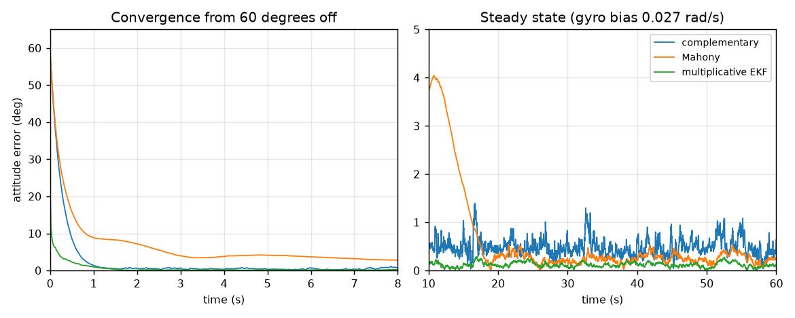
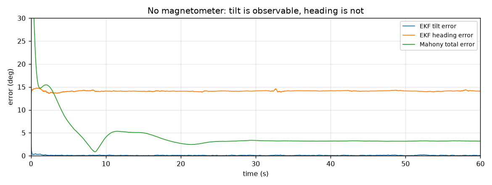

# imufuse

Attitude from a gyro, an accelerometer and a magnetometer, three ways: a complementary filter on Euler angles,
a Mahony filter, and a multiplicative extended Kalman filter with a gyro-bias state. Header-only C++20, no
dependencies, with a synthetic flight to score them on. I wrote it to understand what each filter actually
does with the same data, and why the EKF earns its extra lines.



## What is in it

| Part | File | In short |
|---|---|---|
| Maths | `include/imufuse/math.hpp` | `Vec3`, unit `Quat` (axis-angle, exp map, Euler ZYX, rotate, integrate a body rate), fixed-size `Mat<R,C>` with a Gauss-Jordan inverse, `skew()`. |
| Filters | `include/imufuse/filters.hpp` | One interface: `update(gyro, accel, mag, dt)`, `attitude()`, `gyro_bias()`. Complementary (blend on Euler angles, tilt from accel, tilt-compensated yaw from mag). Mahony (PI feedback of the direction errors, bias estimate). MEKF: nominal quaternion plus bias, 6-state error, accel and mag as direction measurements, Joseph-form covariance update. |
| Flight | `include/imufuse/sim.hpp` | Sum-of-sines rates, true attitude by integration, IMU with white noise and a constant gyro bias, a 63-degree magnetic inclination. `run()` scores a filter. `tilt_error()` and `heading_error()` split the error the way it matters. |
| Demo | `apps/imufuse_sim.cpp` | Runs all three from 60 degrees off and prints a table; `--csv` for the curves, `--no-mag` to switch the field off. |

## Run it

```
cmake -S . -B build
cmake --build build --config Release
ctest --test-dir build -C Release            # 15 tests, under a second
build/Release/imufuse_sim --csv out/errors.csv
build/Release/imufuse_sim --no-mag --csv out/errors-nomag.csv
python tools/plot.py                         # docs/img, needs matplotlib
```

```cpp
#include "imufuse/filters.hpp"
imufuse::Ekf ekf;
ekf.update(gyro_rad_s, accel_m_s2, mag_any_unit, dt);   // every IMU sample
auto [roll, pitch, yaw] = ekf.attitude().to_euler();
```

## Results

60 s flight at 200 Hz, gyro noise 0.005 rad/s, accelerometer noise 0.15 m/s^2, gyro bias 0.027 rad/s, all
three filters started 60 degrees off. Scored from t = 10 s. From `imufuse_sim`:

| Filter | RMS error | Max error | Bias error at the end |
|---|---|---|---|
| Complementary (alpha 0.98) | 0.52 deg | 1.39 deg | not estimated (0.027 rad/s) |
| Mahony (Kp 2, Ki 0.5) | 1.09 deg | 4.04 deg | 0.0016 rad/s |
| Multiplicative EKF | 0.13 deg | 0.29 deg | 0.0001 rad/s |

The complementary filter has no bias state, so its gyro integration is always being pulled back by the
accelerometer, and the pull is what you see as its error. Mahony finds the bias but takes a while, and the
scoring window includes that. The EKF knows how much to trust each source and gets both.

Without a magnetometer (`--no-mag`): the EKF's tilt error stays at 0.09 deg RMS but its heading sits 14
degrees off, which is the heading part of the 60-degree start that nothing can observe. Mahony ends 3.5
degrees off in total for the same reason. The complementary filter has no heading at all without the field.



## What went wrong on the way

Splitting the error into tilt and heading by subtracting Euler angles gave a 7-degree "tilt error" for a
filter that was 0.13 degrees off: roll wraps at 180 degrees and pitch near 90 degrees makes the angles jump.
The split now compares the two "up" vectors in the body frame and the two projected x axes instead.

## Limits

- The flight has no linear acceleration, so the accelerometer always sees gravity. A real vehicle needs the
  accelerometer trust lowered when it is accelerating; the EKF's `Noise::accel` is where that would go.
- The magnetic field is clean. Hard-iron and soft-iron calibration are not here.
- The EKF noise numbers are set by hand, not identified from data.
- Built and tested with MSVC 2022 on Windows; the Linux CI jobs are written but have not run.
